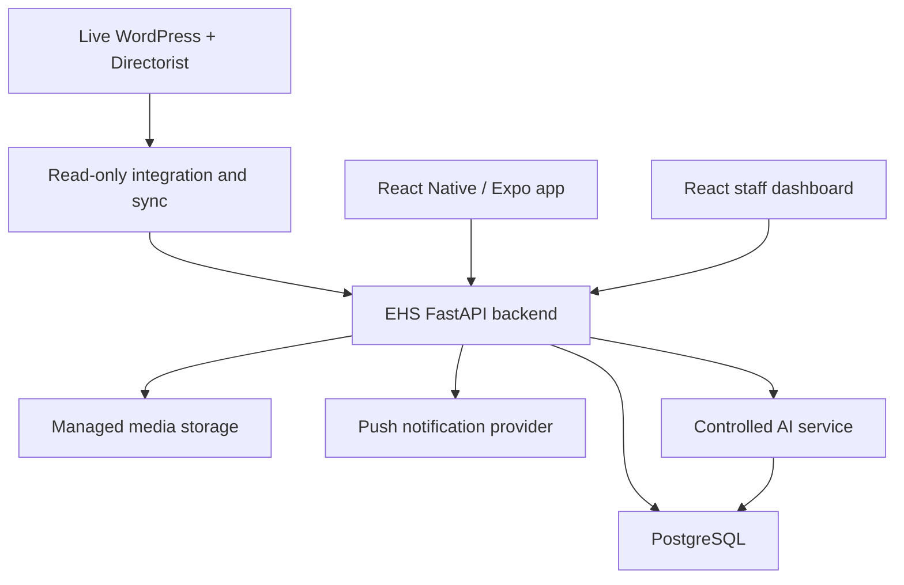
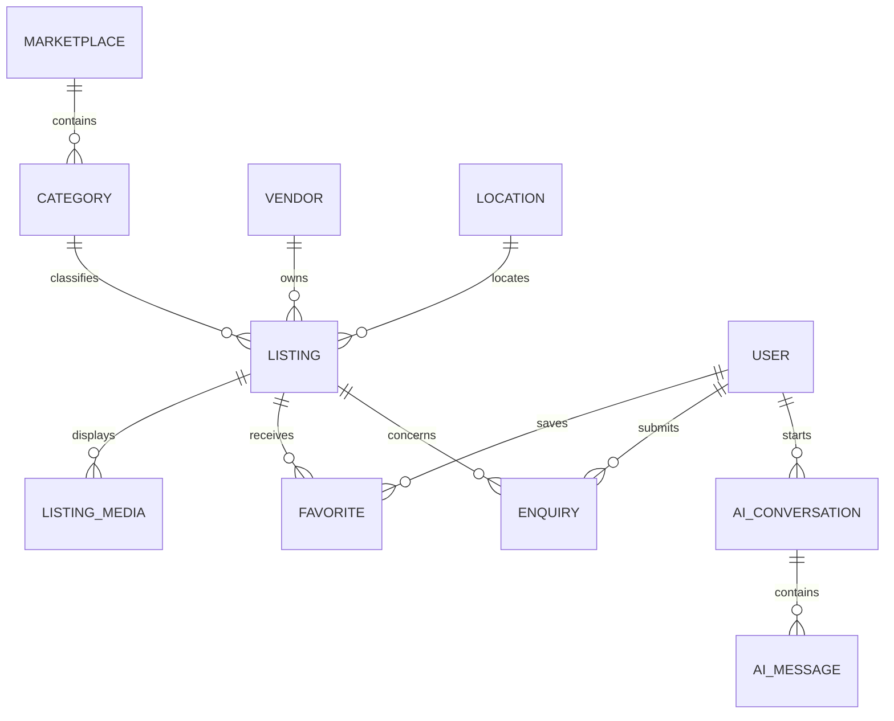

# EHS Mall MVP Architecture and Database Plan

**Document status:** Version 1 — architecture baseline  
**Date:** 31 August 2026  
**Product:** EHS Mall mobile marketplace and AI assistant  
**Existing production website:** [ehsmall.com](https://ehsmall.com/)

## 1. Purpose

This document defines a safe, controlled foundation for a new EHS Mall mobile application while the existing WordPress website remains live and operational.

The long-term vision is an African marketplace covering:

1. Property
2. Construction materials
3. Home and interior products
4. Professional services

The MVP will validate browsing, discovery, saved listings, enquiries and AI-assisted search before EHS invests in multi-vendor checkout, commissions, payouts and logistics.

## 2. Decisions already made

- The existing website must remain available while the app is developed.
- The app will be a new project, with code and infrastructure that the new development team controls.
- The existing website was built by a collaborating developer. Website changes will be coordinated with him rather than assumed.
- The initial website integration will be read-only.
- WordPress/Directorist remains the source of truth for existing published listings during the MVP.
- The new platform will own app-specific accounts, favourites, saved searches, enquiries, notifications, AI conversations and audit records.
- A FastAPI integration layer will shield the mobile app from WordPress-specific response formats.
- The raw Directorist response will not be passed directly to the AI model or exposed unchanged to the mobile app.
- Marketplace payments, vendor payouts and logistics are deferred until business and legal rules are approved.

## 3. Evidence from the supplied website archive

The supplied ZIP is a full WordPress site copy rather than an ordinary planning document.

Confirmed components include:

- WordPress core
- Directorist 8.8.3
- Sydney theme 2.69
- Elementor
- AddonsKit for Elementor
- Header Footer Elementor
- Custom Fonts
- Easy Subscribe
- All-in-One WP Migration
- A `.wpress` migration backup that likely contains the database and uploaded content
- A `wp-config.php` containing database settings and WordPress security secrets

Directorist source code in the archive contains REST controllers for:

- Listings (v1 and v2 code)
- Directories
- Categories, locations and tags
- Users and account/password operations
- User favourites
- Listing reviews
- Temporary media uploads
- Listing actions
- Pages and listing plans
- Checkout, orders, refunds and payments
- Administration and the form builder

These controllers show possible integration capabilities. They do **not** prove that every route is enabled, configured, publicly accessible or appropriate for the mobile app. Live behavior and permissions must be verified on a staging copy or with a restricted test account.

### Archive security classification

The archive is sensitive because it contains configuration secrets and a full migration backup. It must not be committed to Git, placed in the mobile app, shared publicly or used as the starting repository for the new platform. If this archive has previously been shared through an insecure/public channel, the website developer should rotate database credentials, WordPress salts and other exposed secrets.

## 4. MVP product definition

### 4.1 MVP objective

Enable an Android user to discover real EHS listings, find suitable properties/products/services with conventional search or AI assistance, save listings and submit an enquiry without disrupting the existing website.

### 4.2 Customer-facing MVP features

- Four marketplace entry points
- Browse published listings
- Category and location browsing
- Keyword search and basic filters
- Listing details, images and source link
- Seller/agent contact action governed by listing visibility settings
- Customer registration, login, password reset and account deletion
- Favourites
- Saved searches
- Enquiry submission and enquiry history
- EHS AI assistant for listing discovery and approved FAQs
- Push-notification foundation, with only essential notifications enabled initially
- Privacy policy, terms and consent controls

### 4.3 EHS staff MVP features

- Separate protected web dashboard
- View and search customers
- View imported listing summaries and synchronization health
- Review and assign enquiries
- Manage approved AI knowledge articles
- View AI handoffs and user feedback
- Suspend app accounts when authorized
- View audit records and basic operational metrics

### 4.4 Vendor position in MVP

Existing vendors continue managing website listings through the existing workflow. The app displays published listings and delivers enquiries. New mobile vendor listing management is deferred until authenticated Directorist routes and ownership rules have been verified.

### 4.5 Explicitly outside MVP

- Shopping cart and marketplace checkout
- MTN MoMo, Airtel Money, card or bank-transfer processing
- EHS commission settlement
- Automated vendor payouts
- Refund and dispute automation
- Delivery fleet/logistics tracking
- Full vendor inventory and analytics dashboard
- Customer-to-vendor real-time chat
- Mortgage applications or lending decisions
- Advertising sales and campaign management
- Drone footage production, virtual-tour creation or property verification

## 5. System architecture

### 5.1 Recommended technology

| Layer | Recommendation |
|---|---|
| Android/iOS app | React Native with Expo and TypeScript |
| Backend | FastAPI with Python |
| Database | PostgreSQL |
| Database migrations | Alembic |
| Staff dashboard | React with TypeScript |
| Authentication | EHS app tokens with rotating refresh tokens |
| Listing integration | Server-side Directorist adapter and synchronization job |
| AI | Provider-independent service layer with tool-based retrieval |
| Knowledge retrieval | PostgreSQL full-text search first; pgvector only when needed |
| Images for new-platform content | Private managed object storage with signed upload controls |
| Notifications | Expo push initially; email provider for critical/account events |
| Deployment | Separate development, staging and production environments |

The final cloud provider should be selected from actual traffic, budget, team skill and regulatory requirements. The MVP does not require immediate adoption of an expensive enterprise AWS/Azure/GCP architecture.

## 6. Source-of-truth boundaries

| Information | MVP source of truth | Notes |
|---|---|---|
| Existing listing title, price, status, media and vendor contact | WordPress/Directorist | Mirrored into a read model for reliable app search |
| App customer identity | New PostgreSQL platform | Do not automatically equate it with a WordPress user |
| Favourites and saved searches | New PostgreSQL platform | App-owned |
| Enquiries and handoffs | New PostgreSQL platform | App-owned; can notify relevant EHS staff/vendor |
| AI conversations and feedback | New PostgreSQL platform | Retention and consent rules required |
| Approved FAQs/policies | New controlled knowledge records | Every answer source has owner, status and review date |
| Vendor listings created through WordPress | WordPress/Directorist | Until an approved migration/write strategy exists |
| Orders, payments and payouts | Not supported in MVP | Future platform-owned commerce domain |

## 7. Listing synchronization design

The FastAPI backend will not query WordPress for every app screen request. It will maintain a normalized, read-only listing mirror.

### Synchronization flow

1. A scheduled job requests published Directorist listings page by page.
2. The adapter validates and normalizes each response.
3. Each item is upserted using its source system and external listing ID.
4. Categories, locations and media references are synchronized.
5. Listings no longer published are marked unavailable; they are not immediately hard-deleted.
6. The app searches the PostgreSQL mirror.
7. Listing detail may be refreshed from WordPress when data is stale.
8. Failures preserve the last known valid data and create an operational alert.

### Synchronization rules

- Unique identity: `(source_system, external_id)`
- Store the source URL and source modification timestamp.
- Store a checksum of normalized source data to avoid unnecessary updates.
- Never overwrite app-owned analytics, favourites or enquiries during synchronization.
- Sanitize HTML from WordPress before displaying it.
- Do not ingest drafts, private listings or hidden contact fields.
- Apply timeouts, retry limits and rate limits.
- Record every sync run and its counts without storing secrets in logs.

## 8. Roles and authorization

| Role | MVP permissions |
|---|---|
| Guest | Browse/search public listings; use rate-limited public AI; begin an enquiry |
| Customer | Guest abilities plus favourites, saved searches and own enquiry history |
| Vendor | No new write dashboard in MVP; may receive approved enquiries for their published listings |
| Support staff | View and manage assigned enquiries; access approved operational information |
| Content manager | Manage approved AI knowledge and listing classifications, without system administration |
| Administrator | Manage app roles, settings, moderation and audit access |
| System service | Run synchronization and notifications with narrowly scoped machine credentials |

Authorization must be enforced by the backend for every protected operation. Hiding a button in the app is not an authorization control.

## 9. Database plan

All primary keys should use UUIDs except where a justified internal sequence is preferable. All mutable records should include `created_at` and `updated_at`. Personally identifiable information should be minimized.

### 9.1 Identity and access

#### `users`

- `id`
- `email` (normalized, unique when present)
- `phone_country_code`, `phone_number` (normalized)
- `password_hash`
- `display_name`
- `status`: pending, active, suspended, deleted
- `email_verified_at`, `phone_verified_at`
- `last_login_at`
- timestamps

#### `roles`

- `id`
- `code`: customer, vendor, support, content_manager, admin
- `name`

#### `user_roles`

- `user_id`
- `role_id`
- `granted_by_user_id`
- `granted_at`
- unique `(user_id, role_id)`

#### `refresh_tokens`

- `id`, `user_id`
- hashed token identifier
- device/session metadata
- expiry and revocation timestamps

#### `verification_tokens`

- purpose, hashed token, user, expiry, used timestamp

### 9.2 Marketplace catalogue

#### `marketplaces`

- `id`
- `code`: property, construction, home_interior, professional_services
- `name`, `description`
- `is_active`, `sort_order`

#### `categories`

- `id`, `marketplace_id`
- `parent_id` for subcategories
- `external_id` when mirrored from Directorist
- `name`, `slug`
- `is_active`, `sort_order`

#### `locations`

- `id`, `parent_id`
- country, region/district, city/area
- latitude and longitude when approved
- `external_id`, `name`, `slug`

#### `vendors`

- `id`
- `external_owner_id` from WordPress when applicable
- `business_name`, `slug`
- public contact fields
- `verification_status`: unverified, pending, verified, rejected
- `is_active`

The app must not label a vendor “verified” merely because a listing exists.

#### `listings`

- `id`
- `source_system`: directorist or ehs_core
- `external_id`
- `marketplace_id`, `category_id`, `vendor_id`, `location_id`
- `listing_type`
- `title`, sanitized `summary`, sanitized `description`
- `price_amount`, `currency`, `pricing_type`
- `status`: active, unavailable, archived
- `featured`, `average_rating`, `review_count`
- `source_url`, `source_modified_at`, `source_checksum`
- `last_synced_at`
- unique `(source_system, external_id)`

#### `listing_attributes`

- `listing_id`
- `attribute_code`
- typed value columns or validated JSON value
- unique `(listing_id, attribute_code)`

Examples include bedrooms, bathrooms, land size, product unit, brand, service area and experience years. Frequently searched attributes should graduate to indexed typed columns rather than remaining arbitrary JSON.

#### `listing_media`

- `id`, `listing_id`
- `source_url` or managed storage key
- media type, alt text, sort order
- source checksum and timestamps

#### `listing_contacts`

- `listing_id`
- public phone, email, website and WhatsApp fields
- visibility flags copied from the approved source rules

### 9.3 Customer discovery

#### `favorites`

- `user_id`, `listing_id`, `created_at`
- unique `(user_id, listing_id)`

#### `saved_searches`

- `id`, `user_id`, `name`
- validated filter JSON
- notification preference and last-notified timestamp

#### `listing_views`

- listing, pseudonymous session/user reference, timestamp and source
- retain only what is necessary for analytics

### 9.4 Enquiries and support

#### `enquiries`

- `id`, optional `user_id`, `listing_id`
- customer name and consented contact method
- message
- status: new, assigned, in_progress, resolved, closed, spam
- priority, assigned staff member
- timestamps and resolution timestamp

#### `enquiry_events`

- enquiry, actor, event type, safe notes, timestamp
- creates an immutable history of assignment and status changes

#### `staff_notes`

- enquiry, author, note, visibility and timestamp
- never exposed to customers

### 9.5 AI and knowledge

#### `knowledge_articles`

- `id`, title, body, source URL
- owner/approver
- status: draft, approved, retired
- effective/review dates and version

#### `ai_conversations`

- `id`, optional `user_id`, pseudonymous session ID
- consent/retention metadata
- started and closed timestamps

#### `ai_messages`

- conversation, role, redacted content
- model/provider metadata, latency and token/cost fields
- created timestamp

#### `ai_tool_calls`

- message, tool name, safe input summary, result identifiers, outcome and latency
- do not store raw credentials or unnecessary personal data

#### `ai_feedback`

- message/conversation, rating, reason and timestamp

### 9.6 Operations and governance

#### `sync_runs`

- source, start/end time, status
- pages/items read, inserted, updated, unavailable and failed
- safe error summary

#### `notifications`

- user, type, channel, status, payload reference
- scheduled/sent/failed timestamps and retry count

#### `consents`

- user/session, purpose, policy version, granted/withdrawn timestamps

#### `audit_logs`

- actor type/id, action, target type/id
- safe before/after summary, timestamp and request correlation ID
- append-only and sanitized

#### `system_alerts`

- service, alert type, severity, status, occurrence count
- first/last seen and resolution timestamps

## 10. Core relationships

## 11. API boundary for the mobile app

The app will call versioned EHS endpoints such as:

- `GET /api/v1/marketplaces`
- `GET /api/v1/categories`
- `GET /api/v1/locations`
- `GET /api/v1/listings`
- `GET /api/v1/listings/{id}`
- `POST /api/v1/auth/register`
- `POST /api/v1/auth/login`
- `POST /api/v1/auth/refresh`
- `POST /api/v1/auth/password/forgot`
- `DELETE /api/v1/me`
- `GET/POST/DELETE /api/v1/me/favorites`
- `GET/POST/DELETE /api/v1/me/saved-searches`
- `POST /api/v1/enquiries`
- `GET /api/v1/me/enquiries`
- `POST /api/v1/ai/chat`

Directorist URLs, WordPress credentials and raw WordPress objects remain server-side implementation details.

## 12. AI architecture and boundaries

The MVP uses one orchestrator with controlled tools rather than multiple independent agents.

### Tools

- Listing search
- Listing detail retrieval
- Category/location lookup
- Approved knowledge search
- Enquiry creation after user confirmation
- Human-support handoff

### Rules

- Prices, availability, contacts and verification status must come from current structured records.
- The AI cannot publish/edit listings, charge users, promise delivery or declare a vendor verified.
- Enquiry submission requires a clear preview and confirmation.
- Sensitive fields are removed before model calls.
- Public usage is rate-limited and protected against automated abuse.
- Answers distinguish factual EHS information from general guidance.
- Every approved knowledge answer retains its source reference.
- High-risk financial, legal, structural-engineering or mortgage questions receive appropriate limitations and professional referral.

## 13. Security and privacy baseline

- Never embed WordPress administrator credentials in the mobile app.
- Use a restricted, revocable service credential only if authenticated WordPress access is later required.
- Keep secrets in deployment secret management/environment variables.
- Use strong password hashing and rotating refresh-token sessions.
- Apply least privilege to customer, staff and service accounts.
- Encrypt traffic with HTTPS and encrypt managed data at rest.
- Validate file type, size and ownership for all future uploads.
- Apply object-level authorization to every favourite, enquiry and account operation.
- Rate-limit login, password reset, enquiry and AI endpoints.
- Redact passwords, tokens, personal contact data and raw model prompts from logs.
- Provide in-app and web account-deletion paths before Play Store release.
- Define retention periods for enquiries, AI conversations, audit logs and deleted accounts.
- Back up PostgreSQL and test restoration.
- Maintain separate development, staging and production databases.
- Perform dependency, API permission and Play Data Safety reviews before release.

## 14. Migration strategy

### Stage A — coexistence

- Website remains unchanged.
- New backend mirrors only published listing information.
- New app owns customer engagement data.

### Stage B — verified integration

- Test categories, locations, favourites, user and media routes on staging.
- Decide whether any WordPress identity should be linked to an app identity.
- Introduce an explicit account-link table if linking is approved; never match accounts solely by an unverified email address.

### Stage C — vendor platform

- New vendor onboarding and listing-management workflow is implemented in the new backend.
- Define whether new listings are pushed to WordPress or the website begins reading from the EHS API.
- Use one authoritative writer per listing to prevent conflicting edits.

### Stage D — EHS Core

- PostgreSQL becomes the authoritative catalogue when migration acceptance tests pass.
- Website and mobile app both consume the EHS Core API.
- WordPress becomes a presentation/content channel or is retired through a separate approved project.

No cutover occurs without content counts, field mapping, media verification, redirect planning, rollback steps and stakeholder approval.

## 15. Delivery phases and gates

### Phase 0 — audit and specification

- Sanitize and inventory the supplied archive
- Verify the live public routes and response schema
- Establish a staging copy
- Agree MVP categories and listing fields
- Approve roles, privacy rules and enquiry destination
- Produce a field mapping from Directorist to the normalized listing model

**Gate:** No production changes; architecture and data ownership approved.

### Phase 1 — backend foundation

- Create repository structure
- Configure FastAPI, PostgreSQL and Alembic
- Implement configuration validation
- Add identity, roles, audit logging and tests
- Implement read-only Directorist adapter with fixtures

**Gate:** Automated tests pass; no production writes are possible.

### Phase 2 — catalogue prototype

- Synchronize published listings
- Implement marketplaces, categories, locations, search and detail APIs
- Build core Expo screens
- Add error, empty and offline-tolerant states

**Gate:** Prototype displays validated listings without exposing hidden fields.

### Phase 3 — customer engagement

- Add registration, login, account recovery/deletion
- Add favourites, saved searches and enquiries
- Add staff enquiry dashboard
- Add essential notifications

**Gate:** Authorization, privacy and abuse tests pass.

### Phase 4 — AI assistant

- Add approved knowledge records
- Add tool-based listing search and enquiry handoff
- Add model cost limits, feedback and monitoring
- Run factuality and safety evaluation set

**Gate:** AI cannot invent or modify marketplace facts; handoff works.

### Phase 5 — Play Store beta

- Complete accessibility and device testing
- Complete privacy policy, account deletion and Data Safety disclosure
- Produce signed Android build
- Run internal/closed testing and fix launch blockers

**Gate:** Product owner approves release candidate.

## 16. Acceptance criteria for the first demonstrable prototype

- Website remains available and unchanged.
- Backend can import published listings repeatedly without duplicates.
- Imported listing counts and failed items are visible to staff.
- User can browse four marketplace entry points.
- User can search/filter and open a listing.
- Hidden or unpublished source data is not exposed.
- User can submit an enquiry and staff can view it.
- Failure of WordPress does not crash the app; last valid synchronized data remains available.
- No production credential exists in the repository or mobile bundle.
- Automated tests cover normalization, authorization and critical API behavior.

## 17. Open decisions requiring EHS approval

1. Confirm the exact brand spelling: “EHS Mall” versus “EHSMall.”
2. Confirm whether the first app is Android-only or Android-first with later iOS support.
3. Identify the authorized product owner and the person who approves production website changes.
4. Confirm the staff destination for new enquiries.
5. Approve the four marketplace categories and their first-level subcategories.
6. Decide whether MVP users create new app accounts or eventually share WordPress identities.
7. Define which vendor contacts may be shown publicly.
8. Approve privacy retention periods and minimum registration fields.
9. Confirm whether the supplied archive came from production or a local/staging copy.
10. Establish a staging WordPress copy and restricted test account before authenticated API testing.

## 18. Immediate next action

The next engineering action is a non-destructive **live API and archive field-mapping audit**. It should produce:

- Confirmed public endpoints
- Authentication-required endpoints
- Directorist-to-EHS listing field map
- Current category and location inventory
- Contact-visibility rules
- A sanitized JSON fixture for automated tests
- A list of gaps that require the website developer’s input

Only after this audit is approved should Codex scaffold the new FastAPI/PostgreSQL/Expo project.

