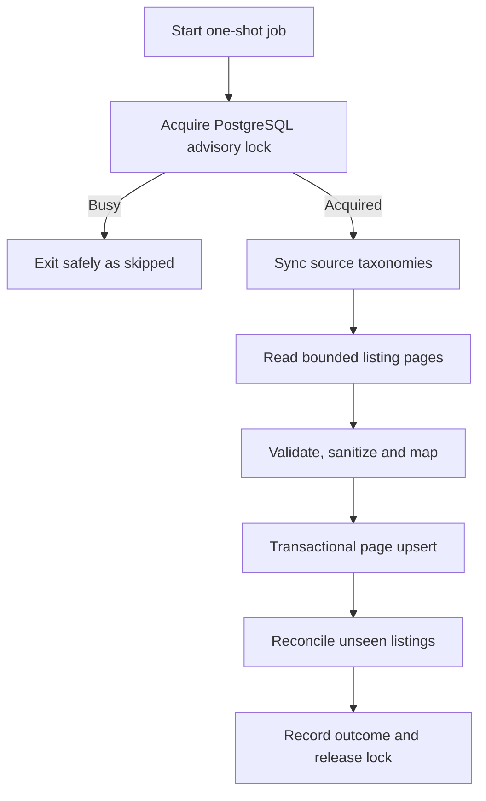

# EHS Mall Phase 1 Repository and Backend Foundation Specification

**Document status:** Version 1 — implementation specification  
**Date:** 31 August 2026  
**Phase:** Repository and backend foundation  
**Predecessors:**

- `EHS_Mall_MVP_Architecture_and_Database_Plan.md`
- `EHS_Mall_Non_Destructive_API_and_Field_Mapping_Audit_v1.md`
- `EHS_Mall_Directorist_Sanitized_Listing_Fixture_v1.json`

## 1. Purpose

This specification defines exactly what Codex may create in Phase 1 and what must remain untouched.

Phase 1 establishes a secure, testable FastAPI/PostgreSQL foundation for the future EHS Mall mobile application. It does not build the complete marketplace, mobile interface, AI agent, vendor portal, checkout or payment system.

## 2. Phase 1 outcome

At completion, the repository must contain:

- A clean monorepo structure
- A runnable FastAPI backend
- PostgreSQL configuration
- Alembic initialized correctly
- Versioned configuration and environment validation
- Initial database models and migrations
- Canonical four-marketplace taxonomy seeds
- A read-only Directorist adapter
- A normalized listing mapper
- A safe synchronization service
- Health and readiness endpoints
- Structured logging and audit foundations
- Automated unit and database tests
- Development documentation
- Explicit technical protection against production WordPress writes

Phase 1 is complete only when its tests pass and a repeatable local setup is documented.

## 3. Locked decisions

### 3.1 Canonical platform

The new PostgreSQL platform owns the canonical EHS taxonomy. It will not reproduce the website’s mixed category tree.

The four canonical marketplaces are:

1. Property
2. Construction
3. Home & Interior
4. Professional Services

The WordPress/Directorist taxonomy is an external source taxonomy. A mapping layer translates it into the EHS canonical taxonomy during synchronization.

### 3.2 Coexistence with the website

- `ehsmall.com` remains live.
- Phase 1 uses public Directorist `GET` endpoints only.
- No WordPress credentials are required.
- No WordPress files or database records are modified.
- No route using POST, PUT, PATCH or DELETE may be called.
- The supplied WordPress ZIP remains outside the Git repository.
- PostgreSQL stores a normalized mirror of public listings, not an authoritative replacement yet.

### 3.3 User identities

New EHS application users will eventually be stored in PostgreSQL. Phase 1 establishes identity tables and security primitives, but public registration/login endpoints are not required until the next customer-engagement phase.

WordPress identities are not automatically imported, matched or linked.

### 3.4 Repository strategy

Use one monorepo named `Ehs-app` for coordinated backend, mobile, dashboard and documentation work. Only the backend is implemented in Phase 1; mobile and admin directories may contain a short placeholder README but no generated application yet.

## 4. Explicit prohibitions

Codex must not:

- Copy the WordPress installation into `Ehs-app`
- Copy `wp-config.php`, `.wpress` backups, database dumps or real secrets
- Use real vendor/customer contact data in tests
- Call authenticated or write-capable WordPress routes
- Install or modify WordPress plugins
- Change the live website
- Build checkout, orders, commissions, payments or payouts
- Build the React Native app or React admin dashboard in Phase 1
- Add an LLM provider or AI-agent implementation
- Add Redis, Kafka, Elasticsearch, Kubernetes or microservices without an approved need
- Create production infrastructure or deploy the application
- Guess unresolved business rules such as default currency or `price=0` meaning
- Automatically update baselines/fixtures when a test fails
- Hide failures with broad exception handling or placeholder success responses

## 5. Monorepo layout

```text
Ehs-app/
├── .editorconfig
├── .gitignore
├── README.md
├── docs/
│   ├── EHS_Mall_MVP_Architecture_and_Database_Plan.md
│   ├── EHS_Mall_Non_Destructive_API_and_Field_Mapping_Audit_v1.md
│   ├── EHS_Mall_Phase_1_Repository_and_Backend_Foundation_Specification.md
│   └── development-setup.md
├── backend/
│   ├── .env.example
│   ├── alembic.ini
│   ├── pyproject.toml
│   ├── README.md
│   ├── alembic/
│   │   ├── env.py
│   │   ├── script.py.mako
│   │   └── versions/
│   ├── app/
│   │   ├── __init__.py
│   │   ├── main.py
│   │   ├── api/
│   │   │   ├── __init__.py
│   │   │   ├── router.py
│   │   │   └── v1/
│   │   │       ├── __init__.py
│   │   │       ├── health.py
│   │   │       └── catalogue.py
│   │   ├── core/
│   │   │   ├── __init__.py
│   │   │   ├── config.py
│   │   │   ├── logging.py
│   │   │   └── security.py
│   │   ├── db/
│   │   │   ├── __init__.py
│   │   │   ├── base.py
│   │   │   ├── session.py
│   │   │   └── models/
│   │   ├── integrations/
│   │   │   └── directorist/
│   │   │       ├── __init__.py
│   │   │       ├── client.py
│   │   │       ├── mapper.py
│   │   │       ├── schemas.py
│   │   │       └── errors.py
│   │   ├── repositories/
│   │   ├── schemas/
│   │   ├── services/
│   │   │   ├── catalogue_sync.py
│   │   │   └── taxonomy_seed.py
│   │   └── jobs/
│   │       └── sync_directorist.py
│   └── tests/
│       ├── conftest.py
│       ├── fixtures/
│       │   └── directorist_listing_v1.json
│       ├── unit/
│       ├── integration/
│       └── database/
├── mobile/
│   └── README.md
└── admin-web/
    └── README.md
```

Do not create empty folders without either an `__init__.py`, `.gitkeep` or useful README explaining their purpose.

## 6. Backend module boundaries

| Module | Responsibility | Must not do |
|---|---|---|
| `api` | HTTP request/response validation and routing | Direct SQL or Directorist calls |
| `core` | Configuration, security primitives and logging | Business workflows |
| `db` | Database engine, sessions and model metadata | Network calls |
| `integrations/directorist` | External API transport, source schemas and mapping | Commit database transactions |
| `repositories` | Database persistence/query operations | HTTP calls or business policy |
| `services` | Transactional business workflows | Depend on FastAPI request objects |
| `jobs` | One-shot operational entry points | Duplicate service logic |
| `schemas` | EHS API/domain validation models | ORM side effects |

Dependencies must point inward: route → service → repository/integration. The Directorist client must not import FastAPI routes or database sessions.

## 7. Configuration specification

Use a typed settings class with startup validation.

### Required settings

- `APP_ENV`: development, test, staging or production
- `DATABASE_URL`
- `DIRECTORIST_BASE_URL`
- `DIRECTORIST_API_VERSION`, initially `v1`
- `DIRECTORIST_REQUEST_TIMEOUT_SECONDS`
- `DIRECTORIST_MAX_PAGES`
- `DIRECTORIST_PAGE_SIZE`
- `LOG_LEVEL`

### Reserved future settings

- Access-token secret and algorithm
- Refresh-token lifetime
- Email provider configuration
- Push-notification configuration
- Object-storage configuration
- LLM provider configuration

Reserved values must not be required in Phase 1.

### Validation rules

- Production must reject localhost database URLs.
- Development/test must not accidentally use a production database hostname.
- `DIRECTORIST_BASE_URL` must use HTTPS outside tests.
- The allowed production Directorist host must be `ehsmall.com` unless explicitly changed later.
- Page size and maximum pages must have safe upper bounds.
- Secrets must never be logged or included in validation errors.
- `.env.example` contains placeholders only.
- `.env`, database files, archives and backups are ignored by Git.

## 8. Canonical taxonomy

### 8.1 Marketplace seeds

| Code | Display name | Initial purpose |
|---|---|---|
| `property` | Property | Sale, rental and development listings |
| `construction` | Construction | Materials and construction supplies |
| `home_interior` | Home & Interior | Home living, fittings, décor and appliances |
| `professional_services` | Professional Services | Built-environment and home services |

Marketplace codes are stable machine identifiers and must not be changed merely to revise display wording.

### 8.2 Initial canonical categories

#### Property

- Homes for Sale
- Land & Plots
- Apartments
- Commercial Properties
- Rental Properties
- Estates
- Hotels
- New Developments

#### Construction

- Cement
- Steel
- Bricks
- Roofing Materials
- Timber
- Plumbing Materials
- Electrical Supplies
- Hardware
- Paint
- Tiles
- Doors
- Windows
- Sanitary Ware
- Finishes
- Solar Systems
- Water Harvesting Solutions
- Smart Home Technologies
- Landscaping Products
- Energy-Efficient Building Materials

#### Home & Interior

- Furniture
- Kitchen Products
- Sanitary Ware
- Tiles
- Lighting
- Home Décor
- Appliances
- Electronics
- Kitchen Equipment

#### Professional Services

- Architects
- Engineers
- Contractors
- Interior Designers
- Property Managers
- Movers
- Cleaning Services
- Quantity Surveyors

Some terms intentionally appear in more than one marketplace, such as Tiles and Sanitary Ware. Categories are scoped to a marketplace and therefore remain distinct records.

### 8.3 Taxonomy constraints

- Category slug unique within its marketplace, not globally.
- Category hierarchy supports parent/child nesting.
- Maximum supported depth for MVP: three category levels.
- A listing may belong to multiple canonical categories.
- A listing has one primary marketplace in MVP.
- Seeds are idempotent and identified by stable codes/slugs.
- Seed reruns must not rename or delete administrator-edited records silently.

## 9. Source taxonomy mapping

Create a mapping model rather than changing WordPress.

### `source_taxonomy_mappings`

- `id` UUID primary key
- `source_system` (`directorist`)
- `source_taxonomy` (`directory`, `category`, `location`)
- `source_external_id` string
- `source_name_snapshot`
- optional `marketplace_id`
- optional `category_id`
- optional `location_id`
- `mapping_status`: pending, approved, rejected
- `mapping_reason`
- `approved_by_user_id` nullable
- timestamps
- unique `(source_system, source_taxonomy, source_external_id)`

### Initial mapping behavior

- Known unambiguous mappings may be seeded as `approved`.
- Ambiguous categories are stored as `pending` and do not get guessed.
- A synchronized listing with an unresolved category is retained but marked `classification_status=pending`.
- Pending classification must be visible in sync metrics and not crash the job.

Examples:

| Directorist category | Canonical target | Initial status |
|---|---|---|
| Cement | Construction → Cement | Approved |
| Steel | Construction → Steel | Approved |
| Commercial Properties | Property → Commercial Properties | Approved |
| Furniture | Home & Interior → Furniture | Approved |
| Engineers | Professional Services → Engineers | Approved |
| Internet Solutions | No approved MVP category | Pending |
| Marketplace | Root container only | Pending/not directly assignable |
| Shopping | Unused legacy root | Pending/review |
| Homes | Ambiguous legacy root | Pending/review |

## 10. Phase 1 database schema

Use PostgreSQL-compatible types and named constraints. Use timezone-aware timestamps. Prefer UUID primary keys for EHS-owned entities. External WordPress IDs are source identifiers, never EHS primary keys.

### 10.1 Identity foundation

#### `users`

- `id` UUID primary key
- normalized `email` nullable
- normalized `phone_e164` nullable
- `password_hash` nullable until authentication is implemented
- `display_name`
- `status`: pending, active, suspended, deleted
- verification timestamps
- `created_at`, `updated_at`, `deleted_at`
- constraint requiring at least one contact identifier before activation, enforced when registration is implemented

#### `roles`

- `id` UUID
- unique stable `code`
- `name`
- `is_system_role`
- timestamps

Seed: customer, vendor, support, content_manager, admin.

#### `user_roles`

- `user_id`, `role_id`
- `granted_by_user_id` nullable
- `granted_at`
- composite unique constraint

No public authentication endpoints are required in Phase 1. Security helpers must be unit-tested independently.

### 10.2 Canonical taxonomy

#### `marketplaces`

- UUID, unique code, name, description
- active flag and sort order
- timestamps

#### `categories`

- UUID, marketplace FK, nullable parent FK
- stable code, slug, display name, description
- active flag and sort order
- timestamps
- unique `(marketplace_id, slug)`
- check preventing self-parenting

Cycle prevention must be enforced in service validation; seed depth stays within the MVP limit.

#### `locations`

- UUID, nullable parent FK
- country code, location type, name, slug
- optional coordinates
- active flag and timestamps
- uniqueness scoped to parent and slug

### 10.3 Source and vendor identity

#### `vendors`

- UUID
- `business_name`, `slug`
- `verification_status`: unverified, pending, verified, rejected
- active flag and timestamps

Phase 1 creates vendor mirrors only when needed to associate listings. A WordPress author must never automatically become a verified vendor.

#### `external_entities`

- UUID
- `source_system`
- `entity_type`: listing, owner, directory, category, location, media
- `external_id`
- optional linked EHS entity type/UUID
- source name snapshot
- first/last observed timestamps
- unique `(source_system, entity_type, external_id)`

Use this generic registry only for identity/linkage. Domain fields remain in their typed tables.

#### `source_taxonomy_mappings`

As specified in Section 9.

### 10.4 Listing mirror

#### `listings`

- UUID primary key
- `source_system`
- `external_id`
- `marketplace_id` nullable while classification is pending
- `vendor_id` nullable
- `primary_location_id` nullable
- title, summary and sanitized description
- source status and normalized status
- `classification_status`: mapped, pending, rejected
- price as `NUMERIC`, nullable
- currency as three-character code, nullable
- pricing type, featured and visibility flags
- source URL
- source created/modified timestamps
- source checksum
- first/last synchronized timestamps
- timestamps and archived timestamp
- unique `(source_system, external_id)`

#### `listing_categories`

- listing FK, category FK
- `is_primary`
- mapping source
- composite unique constraint
- partial/functional rule ensuring no more than one primary category per listing where practical

#### `listing_locations`

- listing FK, location FK
- `is_primary`
- composite unique constraint

#### `listing_media`

- UUID, listing FK
- source external ID and source URL
- media type, alt text, position
- source checksum and timestamps
- unique source media identity within listing

#### `listing_contacts`

- UUID, listing FK
- contact type: email, phone, phone_2, website, fax
- normalized value and safe display value
- `is_public`
- source field
- timestamps

Contacts must not appear in collection API responses. Contact rows are omitted or marked non-public when `owner_contact_hidden=true`.

#### `listing_source_payloads`

- listing FK
- schema version
- sanitized JSON payload
- payload checksum
- observed timestamp

The stored payload must exclude Yoast data, hidden contacts and unnecessary WordPress metadata. Raw unfiltered responses are not stored.

### 10.5 Synchronization and operations

#### `sync_runs`

- UUID
- source system and job name
- status: started, succeeded, partial, failed, skipped
- started/completed timestamps
- pages requested
- counts: received, inserted, updated, unchanged, archived, pending mapping, failed
- safe error code/summary
- correlation ID

#### `sync_item_errors`

- UUID, sync run FK
- external entity type/ID
- error code
- safe field/error summary
- created timestamp
- no raw personal data or secrets

#### `audit_logs`

- UUID
- actor type and optional actor UUID
- action and target type/ID
- safe metadata JSON
- correlation ID, timestamp
- append-only application behavior

#### `system_alerts`

- UUID
- service, alert type, severity and status
- incident key
- first/last seen timestamps, occurrence count
- resolved timestamp and safe details
- unique open incident identity strategy documented in migration/model tests

## 11. Alembic migration plan

Use small, ordered migrations rather than one opaque migration.

1. `0001_identity_foundation`
   - users, roles and user_roles
   - role seeds handled through an idempotent application seed, not fragile migration-time network logic
2. `0002_canonical_taxonomy`
   - marketplaces, categories and locations
3. `0003_sources_and_catalogue`
   - vendors, external entities, mappings, listings and listing relations
4. `0004_sync_and_audit`
   - sync runs, item errors, audit logs and system alerts

Migration requirements:

- No migration imports application services that make network calls.
- Upgrade and downgrade are tested against an empty local test database.
- Upgrade from each previous revision is tested.
- Alembic uses the same SQLAlchemy metadata as the application.
- Startup never calls `create_all()` or silently alters schema.
- Application startup fails clearly when the database is behind the required migration head.
- Seed commands are explicit and idempotent.

## 12. Directorist adapter contract

Define a protocol/interface so source versions can be replaced later.

### Required read methods

- `get_listings_page(page, per_page, modified_after=None)`
- `get_listing(external_id)`
- `get_directories()`
- `get_categories()`
- `get_locations()`

No generic arbitrary-request method may be exposed to services.

### Transport rules

- HTTP `GET` only
- Fixed base host and version from validated configuration
- Connect and read timeouts
- Bounded retry for transient connection/5xx errors only
- No retry for most 4xx responses
- Maximum page guard
- Response content-type and size validation
- Schema validation before mapping
- User-agent identifying the EHS integration
- Correlation IDs in local logs, never as a website mutation
- No Authorization header in Phase 1
- No automatic redirects to a different host

### Error taxonomy

- `DirectoristUnavailableError`
- `DirectoristTimeoutError`
- `DirectoristRateLimitError`
- `DirectoristResponseFormatError`
- `DirectoristSchemaError`
- `DirectoristPaginationError`

Services translate integration errors into controlled sync outcomes. They must not expose stack traces or raw upstream bodies through the public API.

## 13. Source and normalized schemas

### Source schemas

Model the audited v1 fields with strict required identity fields and tolerant optional fields.

Rules:

- Unknown source fields are ignored and counted/logged safely, not fatal by default.
- Missing `id`, `name`, `status` or permalink is a record error.
- Numeric strings for coordinates require explicit parsing.
- Empty date strings become null.
- Price uses decimal conversion.
- HTML is sanitized before persistence.
- Invalid image/contact URLs are rejected for that field, not allowed to poison the record.

### Normalized schemas

Create separate models for:

- Internal normalized listing
- Public listing summary
- Public listing detail
- Internal synchronization result
- Taxonomy result
- Health/readiness responses

Public schemas must not contain:

- WordPress author IDs
- Hidden contacts
- Source payloads
- Yoast metadata
- Internal mapping state details beyond a safe availability outcome
- Audit/error details

## 14. Synchronization workflow



### Required behavior

- Run as an explicit one-shot command: `python -m app.jobs.sync_directorist`.
- Use a PostgreSQL advisory lock to prevent overlap.
- Create one `sync_runs` record per attempt.
- Synchronize taxonomy before listings.
- Process listings in bounded pages.
- Calculate a checksum of normalized source data.
- Insert new records, update changed records and count unchanged records.
- Make each page transactional so one malformed record can be isolated according to tested policy.
- Preserve app-owned fields and relationships.
- Do not hard-delete a listing merely because one request failed.
- Mark a previously observed listing unavailable only after a complete successful source traversal proves it unseen.
- If traversal is partial or failed, do not archive unseen listings.
- Repeated execution against unchanged data must be idempotent.
- Job lifecycle logs must exclude contact values and raw descriptions.

### Exit codes

| Code | Meaning |
|---:|---|
| 0 | Successful synchronization |
| 2 | Another sync already running; safely skipped |
| 3 | Completed with isolated item failures/partial result |
| 10 | Configuration failure |
| 11 | Database/migration failure |
| 12 | Upstream Directorist failure |
| 13 | Unexpected controlled failure |

Exact codes may change only through a documented specification update.

## 15. Initial API surface

### Operational routes

- `GET /health/live`
  - Confirms application process is running
  - No database or external network dependency
- `GET /health/ready`
  - Confirms database connectivity and expected migration head
  - Does not require Directorist to be currently online

### Read-only catalogue routes

- `GET /api/v1/marketplaces`
- `GET /api/v1/categories`
- `GET /api/v1/locations`
- `GET /api/v1/listings`
- `GET /api/v1/listings/{id}`

Catalogue endpoints may be implemented in Phase 1 only to the extent needed to verify the normalized model. They are read-only.

### API rules

- Stable EHS UUIDs in public URLs
- Bounded page size
- Validated filter allowlist
- Deterministic ordering with ID tie-breaker
- Consistent error envelope
- No raw exception messages
- OpenAPI descriptions distinguishing EHS data from source website data
- Contacts excluded from collection responses

## 16. Logging, audit and observability

Use structured JSON-compatible logs outside local human-readable development mode.

Every request/job should have a correlation ID. Log:

- Event name
- Severity
- Environment
- Correlation ID
- Safe entity identifiers
- Duration and outcome

Never log:

- Passwords or tokens
- Database URLs
- Full request/response bodies
- Emails, phone numbers or addresses
- Raw listing descriptions
- WordPress configuration values

Phase 1 metrics may be represented in `sync_runs`; an external metrics platform is not required yet.

## 17. Security foundation

- Password hashing helper using a current password-hashing algorithm supported by the chosen Python security library
- Constant-time verification through the library
- No custom cryptography
- Generic authentication error messages for future use
- CORS disabled by default except explicitly configured development origins
- Trusted hosts configurable by environment
- Security headers added where appropriate
- Request-size limits
- Strict JSON content handling
- Dependency versions locked after compatibility is verified
- Automated secret scanning or at minimum repository checks for forbidden sensitive filenames/patterns

Do not activate incomplete authentication routes merely because helper functions exist.

## 18. Testing specification

### Unit tests

- Source schema parsing
- HTML sanitization
- Date, coordinate and Decimal conversion
- Category mapping
- Unknown/ambiguous category behavior
- Contact visibility enforcement
- Public response field allowlists
- Checksum stability
- Error translation
- Configuration validation

### Adapter tests

- Use mocked HTTP responses only
- Use the sanitized fixture
- Pagination headers
- Timeout and transient retry behavior
- Wrong content type
- Invalid JSON
- Oversized/unexpected response
- Redirect to disallowed host
- Missing required fields
- No non-GET request can be produced

### Database tests

- Migration upgrade chain
- Constraints and unique identities
- Idempotent seeds
- Idempotent listing upserts
- Multiple categories per listing
- Pending taxonomy mapping
- No hard deletion on partial sync
- Archival only after complete traversal
- Advisory lock overlap behavior
- Audit and sync records contain no prohibited fields

### API tests

- Liveness and readiness behavior
- Pagination validation
- Listing summary/detail schemas
- Contacts absent from collection responses
- Unknown UUID returns controlled 404
- Internal source metadata absent from public responses

### Regression rule

The sanitized fixture is a reviewed baseline. Tests must fail clearly when the source schema changes. Codex must not automatically rewrite the fixture to make a failure pass.

## 19. Local development and quality commands

The backend README must document platform-appropriate commands for:

- Creating/activating a virtual environment
- Installing locked development dependencies
- Creating a local PostgreSQL database
- Copying `.env.example` to `.env`
- Running Alembic upgrades
- Seeding taxonomy
- Starting FastAPI
- Running the one-shot fixture-based sync in test mode
- Running formatting, linting, type checks and tests

The exact tool versions are selected at implementation time and pinned. The project should use one formatter/linter strategy, one type checker and pytest rather than overlapping tools with conflicting configuration.

## 20. Git and repository safety

`.gitignore` must cover at least:

- `.env` and environment-specific secret files
- Python virtual environments and caches
- Test and coverage artifacts
- IDE-local settings where appropriate
- Database files and dumps
- `wp-config.php`
- `*.sql`, `*.wpress`
- WordPress archives and extracted WordPress directories
- Uploaded customer/vendor media
- OS-generated files

Before the first push, run a tracked-file review and a secret scan. The supplied `ehsmall.zip` must not enter Git history.

## 21. Implementation sequence for Codex

Codex must execute Phase 1 in small gates.

### Gate 1 — non-mutating repository audit

- Inspect the actual `Ehs-app` directory
- Report existing files, Git status and detected tooling
- Confirm the sensitive WordPress archive is outside the repository
- Propose exact files to add
- Make no changes

### Gate 2 — repository skeleton

- Add root metadata, documentation links and backend package structure
- Add `.gitignore` protections first
- Add dependency/configuration files
- Verify imports and configuration tests

### Gate 3 — database and migrations

- Add models in bounded groups
- Create the four specified migrations
- Test clean upgrade/downgrade/upgrade locally
- Add explicit seed command and tests

### Gate 4 — Directorist adapter and mapper

- Add schemas and GET-only client
- Copy the approved synthetic fixture into tests
- Add unit tests before any live smoke test
- Prove that no write method is possible

### Gate 5 — synchronization

- Implement service, repositories, advisory lock and job
- Test idempotency, partial failure and reconciliation
- Run against mocks/local database first
- Request approval before a live public GET smoke test

### Gate 6 — read APIs and verification

- Add health and minimal catalogue routes
- Run the full quality suite
- Produce a Phase 1 completion report
- Do not deploy

Each gate must stop for review before the next substantial gate. Codex must preserve user changes and report any dirty-worktree overlap.

## 22. Phase 1 acceptance criteria

Phase 1 passes only when:

- Repository contains no WordPress copy, backup or secret
- Application starts with valid local configuration
- Invalid or unsafe configuration fails clearly
- Alembic is the only schema-creation mechanism
- Empty database upgrades to head successfully
- Migration downgrade/upgrade rehearsal succeeds
- Four marketplaces and approved categories seed idempotently
- Directorist adapter can issue only allowed GET operations
- Synthetic fixture maps into normalized records
- Listings upsert idempotently
- Pending source categories remain visible for review
- Partial sync cannot archive valid listings
- Public schemas omit contacts/internal source metadata as specified
- Logs and audit records contain no secret/contact values
- Full automated test suite passes
- Documentation lets another developer reproduce local setup
- No production website or production database has been changed

## 23. Phase 1 completion report format

Codex must report:

- Files added/changed
- Final migration head and migration order
- Canonical seed counts
- Test counts and exact commands
- Live-network calls performed, if any
- Database used for testing
- Known limitations
- Confirmation that no WordPress write occurred
- Confirmation that no secret/archive entered Git
- Recommended next gate

## 24. Decisions deferred without blocking Phase 1

These remain explicit configuration/business decisions:

- Final default and multi-currency rules
- Meaning of `price=0`
- Enquiry destination and workflow
- Shared app/WordPress identity strategy
- Vendor onboarding and verification policy
- Listing-contact reveal UX
- Production cloud provider
- Production domain names for API/admin
- Payment partner, commission and payout rules
- Data-retention periods requiring legal/business approval

No Phase 1 code should silently decide these items.

## 25. Next instruction after approval

After this specification is reviewed, the first Codex instruction should authorize **Gate 1 only**: a non-mutating audit of the local `Ehs-app` folder. It should not ask Codex to scaffold the project yet.

